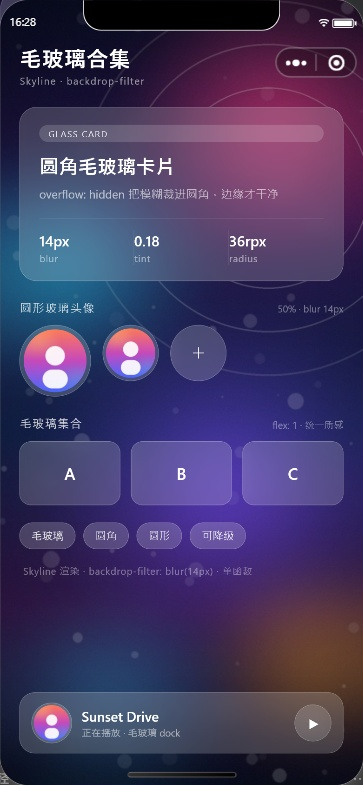

# uiskills

[](LICENSE)
[](https://github.com/hellogitd/uiskills/releases)
[](#技能列表)
[](#)

**给 AI Agent 用的 UI 技能集合**。每个子目录是一个可独立安装的 skill，里面是「可直接抄的代码 + 配置 + 踩坑清单 + 验收标准」，而不只是几句提示词。

当前第一个技能：**毛玻璃（glassmorphism）**，同时附带能直接跑起来的 uni-app / 原生小程序 demo。



> 截图是微信开发者工具 **Skyline 渲染引擎**（基础库 3.17.6）的真实渲染结果，不是设计稿。

## 技能列表

| 技能 | 内容 |
| --- | --- |
| [glassmorphism](glassmorphism/) | 圆角玻璃卡片、圆形玻璃头像、玻璃按钮 / 胶囊标签 / 悬浮 glass dock；含 Skyline 配置、`glass-view` / `glass-avatar` 组件、16 条踩坑清单、WebView 降级方案 |

## 快速开始

### 原生小程序

1. 微信开发者工具 → 导入项目 → 选 `glassmorphism/assets/mp-weixin`
2. AppID 用「测试号」，或把 `project.config.json` 里的 `appid` 换成自己的
3. 确认基础库 ≥ 3.0.2，打开 `pages/glass-demo/glass-demo`

> 工程已配好 Skyline：`app.json` 的 `renderer / componentFramework / rendererOptions.skyline`，页面 json 的 `renderer / navigationStyle: custom`。

### uni-app（Vue 3）

1. HBuilderX 导入 `glassmorphism/assets/uni-app`
2. 运行到微信小程序（需 HBuilderX 3.7.6+；CLI 需 `@dcloudio/*` ≥ `3.0.0-3090420231025001`）
3. 页面：`pages/glass-demo`（整页示例）、`pages/glass-components`（`glass-view` / `glass-avatar` 组件演示）
4. 编译后检查 `dist/dev/mp-weixin/app.json` 是否生成 `"renderer": "skyline"`（uni-app 对 skyline 字段的透传依赖版本）

> CLI 用户注意：默认入口目录是 `src/`，把 `assets/uni-app` 的内容放进 `src/` 再构建，或设置 `UNI_INPUT_DIR`。
> 已验证的构建组合：`@dcloudio/* 3.0.0-5030420261029002`（vue3 dist-tag）+ `vite 5.2.8` + `vue 3.4.21`，编译器 5.34（vue3）。

## 安装为 AI Skill

方式一：直接从 [Releases](https://github.com/hellogitd/uiskills/releases) 下载 `uiskills-glassmorphism.zip`，解压得到 `glassmorphism/`，整个放进你的 agent skills 目录即可（保持 `SKILL.md` 在目录根部）。

方式二：从源码安装：

```bash
git clone https://github.com/hellogitd/uiskills.git

# 把技能拷进你的 agent skills 目录（以实际配置为准）
cp -r uiskills/glassmorphism <your-skills-dir>/
```

Windows PowerShell：

```powershell
git clone https://github.com/hellogitd/uiskills.git
Copy-Item -Recurse .\uiskills\glassmorphism <your-skills-dir>\
```

保持 `SKILL.md` 在技能目录根部即可。之后当你说「做一个毛玻璃卡片」「玻璃拟态头像」「backdrop-filter 圆角卡片」时，agent 会自动加载这份技能；也可以显式点名：「用 glassmorphism skill 做一版毛玻璃首页」。

技能结构：

```
glassmorphism/
├── SKILL.md                  # 主入口：4 条硬规则、配置、CSS、验收清单、症状速查
├── references/
│   ├── skyline-config.md     # Skyline 完整配置、版本门槛、平台限制、排错
│   ├── pitfalls.md           # 16 条踩坑（现象 / 原因 / 解法）
│   ├── components-api.md     # glass-view / glass-avatar 全部 props 与示例
│   └── compatibility.md      # WebView 回退、@supports 失效、预模糊层、真机验证
├── assets/
│   ├── uni-app/              # 完整 uni-app 工程（Vue3，可导入 HBuilderX）
│   └── mp-weixin/            # 完整原生小程序工程（可导入微信开发者工具）
└── preview/demo-skyline.jpg  # 实测截图
```

## 为什么会有这个仓库

AI 写毛玻璃十次有八次会踩同一个坑：写了 `border-radius` 没写 `overflow: hidden`，或者忘了开 Skyline，或者用 `@supports` 做降级——而 WXSS 根本不支持 `@supports`。

所以这个仓库把「验证过的正确写法」连同样例和验证标准一起打包，让 agent 一次写对。核心结论：

1. **必须 Skyline**：`app.json` 三件套 + `rendererOptions.skyline.disableABTest = true`，否则真机可能仍是 WebView。
2. **`backdrop-filter` 只写单函数**：Skyline 官方只支持一个 filter-function，`blur() saturate()` 这种写法有失效风险，模板统一用 `blur(14px)`。
3. **`@supports` 在 WXSS 里不生效**（实测连 `display:flex` 都不匹配），降级靠「永远保留 tint」或「预模糊背景层」。
4. **`border-radius` 与 `overflow: hidden` 写同一个节点**，WebView 回退时才不会让模糊溢出圆角。

参数经验值、16 条坑位、降级方案都在 [glassmorphism/references](glassmorphism/references/) 里。

## 实测环境

| 项 | 值 |
| --- | --- |
| 工具 | 微信开发者工具（Skyline 渲染） |
| 基础库 | WeChatLib 3.17.6（2026-10-30） |
| 原生版 | 开发者工具直接导入、实际渲染，截图见上 |
| uni-app 版 | CLI 构建到 `mp-weixin`：产物 `app.json` / 页面 json 均保留 `renderer: skyline`，`glass-view` / `glass-avatar` 组件也编译进产物 |
| 验证内容 | 模糊生效、圆角裁剪、`@supports` 不生效、单函数模糊、安全区适配 |

> 桌面端微信 / Mac / 企业微信暂不支持 Skyline，会回退 WebView；上线前请用 iOS + Android 真机各验一次（见 [compatibility.md](glassmorphism/references/compatibility.md)）。

## 素材

`static/bg.jpg`、`static/avatar.jpg` 都是脚本合成的，无版权问题，可用 `tools/gen_assets.py` 重新生成：

```bash
python tools/gen_assets.py
```

## 目录

```
uiskills/
├── README.md
├── LICENSE                   # MIT
├── tools/gen_assets.py       # 演示背景图 / 头像生成脚本
└── glassmorphism/            # 技能本体（拷这个目录即可安装）
```

## License

[MIT](LICENSE) © [hellogitd](https://github.com/hellogitd)
